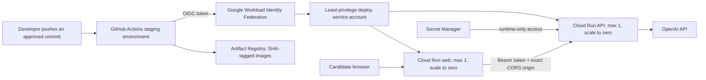
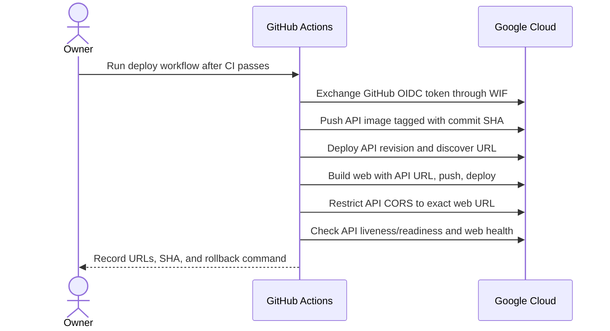

# Step 9: production containers and Cloud Run delivery

## Outcome

Step 9 makes the application reproducibly deployable to a low-cost Google Cloud
staging environment. It adds hardened production images, container smoke tests,
critical-vulnerability scanning, keyless GitHub authentication, immutable image
tags, Cloud Run deployment, exact-origin CORS, health checks, and rollback
instructions. Cloud resources have not yet been created from this workstation.

## Deployment architecture



The staging API uses `GRADPATH_RETRIEVAL_BACKEND=lexical`. This preserves the
evidence-grounded workflow without paying for an always-on database. Hybrid RAG
with PostgreSQL/pgvector remains the default and is exercised in CI; a later
production milestone should add managed PostgreSQL before claiming the hosted
demo uses hybrid RAG.

## Delivery sequence



## One-time Google Cloud setup

1. Create or select a Google Cloud project and attach billing. Set a small
   budget alert before deploying. A budget alert warns; it does not automatically
   stop usage.
2. Open Google Cloud Shell and run:

   ```bash
   export PROJECT_ID="your-project-id"
   export GITHUB_REPOSITORY="TheeHarpreet/gradpath-ai"
   bash scripts/gcp/bootstrap-cloud-run.sh
   ```

3. In Secret Manager, add a value to `gradpath-openai-api-key` and generate a
   long random value for `gradpath-demo-access-token`. Never paste either into a
   GitHub variable, repository file, issue, or workflow log.
4. In GitHub, create the `staging` Environment and add the six variables printed
   by the script. Add a required reviewer if the repository plan supports it.
5. Run **Deploy staging to Cloud Run** manually from GitHub Actions.

The bootstrap is deliberately idempotent and narrowly scopes secret access to
the runtime service account. The GitHub identity is restricted to this exact
repository and uses short-lived federation rather than a downloaded JSON key.

## Verification and rollback

The workflow checks `/health/live`, `/health/ready`, and the web `/health`
endpoint. Also complete a browser analysis using fictional data after each
meaningful release.

List revisions and return 100% of traffic to a known-good one:

```bash
gcloud run revisions list --service gradpath-api-staging --region europe-west1
gcloud run services update-traffic gradpath-api-staging --to-revisions REVISION=100 --region europe-west1
```

Repeat for `gradpath-web-staging` when necessary. Cloud Run revisions are
immutable, so rollback changes traffic rather than rebuilding an old image.

## Cost and operations guardrails

- Cloud Run services scale to zero and are capped at one instance for staging.
- Keep request logs free of CV/JD bodies and secrets; Step 8 already implements
  safe, request-correlated logging.
- Configure billing alerts at conservative thresholds and monitor Cloud Run
  request count, error rate, latency, instance count, and OpenAI usage.
- Disable or delete the two Cloud Run services when the public demo is no longer
  needed. Retaining Artifact Registry images and secrets may still incur small
  charges.
- Public ingress makes the browser demo reachable, but analysis routes still
  require the app bearer token and are rate limited. This is demo access control,
  not full end-user authentication.

## Remaining deployment gate

The repository configuration is ready for validation in CI, but no live URL is
claimed until the project, billing, secrets, federated identity, and first
workflow run have been completed and smoke-tested. This distinction should be
kept explicit in the README, CV, and interviews.

## Official references

- [Deploying containers to Cloud Run](https://docs.cloud.google.com/run/docs/deploying)
- [Cloud Run health checks](https://docs.cloud.google.com/run/docs/configuring/healthchecks)
- [Cloud Run rollbacks and traffic migration](https://docs.cloud.google.com/run/docs/rollouts-rollbacks-traffic-migration)
- [Workload Identity Federation for deployment pipelines](https://docs.cloud.google.com/iam/docs/workload-identity-federation-with-deployment-pipelines)
- [Cloud Billing budgets and alerts](https://docs.cloud.google.com/billing/docs/how-to/budgets)
